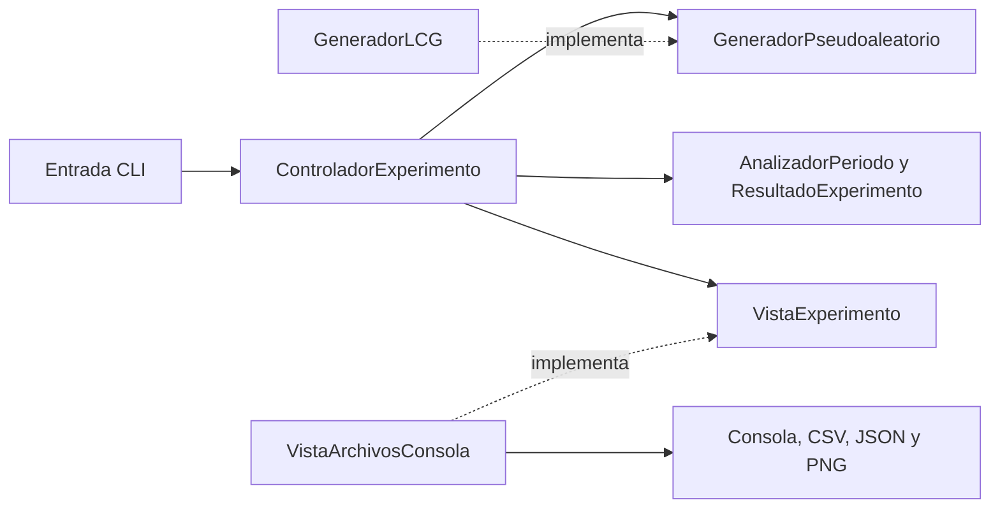

# APE 05 — Generador Congruencial Lineal en Python y Java

Práctica de **Simulación, quinto ciclo de Computación**. Implementa los ocho pasos de la guía de la semana 5 y utiliza sus diapositivas para explicar el período y las limitaciones del generador.

El proyecto ya incluye resultados ejecutados: [informe con tablas, gráficas, análisis, preguntas y conclusiones](resultados/informe.md). La cobertura de cada requisito está en [docs/requisitos.md](docs/requisitos.md); las cinco revisiones están en [docs/revisiones.md](docs/revisiones.md).

## Requisitos

- Linux o macOS y Bash.
- Python **3.11 o superior**, con `venv` y `pip`. El entorno comprobado usa Python **3.14.4**.
- **JDK 21 o superior** y **Maven 3.9 o superior**. Comprobado con OpenJDK **21.0.12.1** y Maven **3.9.12**.
- Internet para descargar dependencias la primera vez.

Python utiliza Matplotlib para los PNG. Java usa únicamente clases del JDK en ejecución: Java2D para los PNG y `BigInteger` para la recurrencia exacta; JUnit es una dependencia exclusiva de pruebas. Ambos funcionan sin una ventana gráfica.

## Preparar y ejecutar todo

Desde esta carpeta `05APE`:

```bash
bash scripts/preparar.sh
bash scripts/ejecutar.sh
```

La preparación crea `.venv`, instala el paquete Python en modo editable y compila y prueba Java mediante `java/pom.xml`. La ejecución recompila Java, genera 10 000 salidas con cada semilla en cada lenguaje, comprueba sus datos y reconstruye el informe. Las salidas anteriores con esos nombres se reemplazan.

Los scripts resuelven la raíz desde su propia ubicación, por lo que también se pueden invocar con una ruta absoluta desde otro directorio. El entorno virtual se crea localmente; debe recrearse al trasladar la carpeta a otra computadora.

Para comprobar pruebas y ejecución integrada:

```bash
bash scripts/verificar.sh
```

## Ejecutar Python por separado

```bash
source .venv/bin/activate
python -m lcg_practica --semilla 12345 --cantidad 10000 --salida resultados/python
deactivate
```

También se puede usar `.venv/bin/python -m lcg_practica` sin activar el entorno, o el comando instalado `.venv/bin/ape05-python`. El programa acepta `--help`.

Instalación manual equivalente:

```bash
python3 -m venv .venv
.venv/bin/python -m pip install -r python/requirements.txt
.venv/bin/python -m pip install --no-deps -e ./python
```

[python/requirements.txt](python/requirements.txt) contiene la dependencia directa y [python/requirements-lock.txt](python/requirements-lock.txt) registra las versiones exactas del entorno verificado con Python 3.14.4. Para reproducir ese entorno, sustituye el primer archivo por el segundo en el comando de instalación. En otros intérpretes se utiliza el archivo de dependencias directas para resolver versiones compatibles.

## Ejecutar Java por separado

```bash
mvn -B -ntp -f java/pom.xml verify
java -Djava.awt.headless=true -jar java/target/ape05-lcg-1.0.0.jar \
  --semilla 12345 --cantidad 10000 --salida resultados/java
```

El JAR contiene la clase principal y funciona sin Python. Los argumentos disponibles son `--semilla`, `--cantidad`, `--salida` y `--help`. Desde un IDE, abre `java/pom.xml` como proyecto Maven, selecciona JDK 21 y ejecuta `ec.edu.simulacion.App`.

## Parámetros y decisiones del experimento

```text
X(n+1) = (a * X(n) + c) mod m
Un = Xn / m
a = 1664525
c = 1013904223
m = 2^32 = 4294967296
X0 = 12345
cantidad = 10000
```

Estos son los parámetros de la guía. La primera observación es **X1**, no X0; para la semilla 12345, `X1=87628868`. La normalización utiliza división real y produce valores en `[0,1)`.

Para cumplir «cambiar la semilla», se eligió **54321** como segundo experimento, manteniendo a, c y m. La guía no prescribe ese segundo número. Los ejecutables permiten otras semillas enteras en `[0,m)` y cantidades entre 1 y 1 000 000; este límite de cantidad es una decisión operativa. Los modelos admiten módulos entre 1 y `2^32`, mientras los ejecutables mantienen fijos los parámetros solicitados.

Las pruebas con parámetros pequeños sirven para comprobar el analizador de ciclos. Los experimentos entregados utilizan exclusivamente los parámetros de la guía. Las estadísticas descriptivas y la gráfica de pares complementan el análisis según las diapositivas; no se incluyen pruebas estadísticas de la semana 6.

## Resultados y comparación

```text
resultados/
├── python/
│   ├── semilla_12345.csv / .json / .png
│   └── semilla_54321.csv / .json / .png
├── java/
│   ├── semilla_12345.csv / .json / .png
│   └── semilla_54321.csv / .json / .png
├── comparacion_20_semilla_12345.csv
├── comparacion_20_semilla_54321.csv
└── informe.md
```

- Los CSV completos contienen `n,x,u` y 10 000 filas de datos cada uno.
- Los JSON registran parámetros, cantidad, Hull–Dobell, ciclo observado y estadísticas descriptivas.
- Cada PNG muestra todas las salidas, un detalle de las primeras 200 y los pares consecutivos `(Un,Un+1)`.
- Las dos tablas comparativas incluyen los enteros y normalizados de ambos lenguajes en las primeras 20 posiciones.
- El informe responde las cinco preguntas de control y presenta conclusiones basadas en los resultados.

Después de ejecutar ambos programas con las dos semillas se puede repetir solamente la comparación:

```bash
.venv/bin/python scripts/comparar.py
```

El comparador exige los **10 000 pares idénticos por semilla**, verifica índices, recurrencia, normalización, rangos, estadísticas y metadatos y comprueba la presencia de los PNG. Compara números, porque los formatos textuales válidos del CSV pueden diferir entre lenguajes. En esta práctica `Xn/2^32` es representable exactamente en `double`/`float`; los decimales de consola se muestran de forma exacta. El informe redondea a 12 decimales para facilitar la lectura.

Resultado comprobado: **20 000 pares Python/Java coincidentes**, considerando ambas semillas, y **14 pruebas unitarias aprobadas**, siete por lenguaje.

El período es **4 294 967 296**, justificado por las tres condiciones de Hull–Dobell. En 10 000 salidas no se observó el cierre del ciclo; la longitud de la muestra no debe reportarse como período. [El informe desarrolla el cálculo](resultados/informe.md).

## Arquitectura MVC, POO y patrón Strategy



| Capa | Python | Java | Responsabilidad |
|:---|:---|:---|:---|
| Modelo | `modelo.py` | paquete `modelo` | Parámetros, estado del LCG, resultado y análisis del período. |
| Vista | `vista.py` | paquete `vista` | Presentar y exportar resultados, sin generar la secuencia. |
| Controlador | `controlador.py` | paquete `controlador` | Validar cantidad y coordinar generación, análisis y presentación. |
| Composición | `__main__.py` | `App.java` | Leer opciones y construir dependencias. |

Se utiliza **Strategy**: el controlador recibe el contrato `GeneradorPseudoaleatorio` y la implementación `GeneradorLCG`. Es adecuado para separar el algoritmo de su uso y permitir una estrategia de prueba sin cambiar el controlador. No existe un patrón universalmente «más óptimo»: aquí se eligió uno pequeño que se puede justificar sin añadir algoritmos ajenos a la práctica. Las dependencias se inyectan mediante el constructor y los argumentos del controlador.

POO se aplica mediante clases, encapsulación del estado y objetos inmutables para parámetros y resultados. En Python se usan `dataclass` y `Protocol`; en Java, `record` e interfaces.

| Principio SOLID | Aplicación concreta |
|:---|:---|
| S — responsabilidad única | El generador calcula estados; el analizador estudia ciclos; la vista presenta; el controlador coordina. |
| O — abierto/cerrado | El controlador admite otra implementación del contrato sin modificar su coordinación. |
| L — sustitución | Las estrategias respetan `siguiente() -> estado entero`; las pruebas inyectan una estrategia controlada. |
| I — interfaces pequeñas | La estrategia expone `siguiente` y la vista `presentar`, sin métodos ajenos al consumidor. |
| D — inversión de dependencias | El controlador utiliza contratos de generación y presentación; el punto de entrada conecta las clases concretas. |

Clean Code se refleja en nombres del dominio, validaciones explícitas, métodos con tareas delimitadas, parámetros inmutables y separación de cálculo y entrada/salida. El comparador es una herramienta de verificación entre aplicaciones y no participa en sus modelos MVC.

## Estructura del código

```text
05APE/
├── ape_guia simulacion semana 5.pdf
├── .venv/                        # local, excluido de Git
├── python/
│   ├── pyproject.toml
│   ├── requirements.txt
│   ├── requirements-lock.txt
│   ├── src/lcg_practica/
│   └── tests/test_modelo.py
├── java/
│   ├── pom.xml
│   ├── src/main/java/ec/edu/simulacion/
│   └── src/test/java/ec/edu/simulacion/
├── scripts/                      # preparar, ejecutar, verificar, comparar
├── docs/                         # fundamento, requisitos, fuentes y revisiones
└── resultados/                   # evidencia reproducible
```

## Pruebas y errores frecuentes

Las pruebas comprueban un vector conocido, continuidad del estado, reproducibilidad de 10 000 valores, cambio de semilla, rangos, validación, aritmética extrema, las tres condiciones de Hull–Dobell, un ciclo completo pequeño y un ejemplo con etapa previa al ciclo. También comprueban que el controlador admite dependencias de prueba.

```bash
.venv/bin/python -m unittest discover -s python/tests -v
mvn -B -ntp -f java/pom.xml test
```

- `No module named lcg_practica`: prepara el entorno y utiliza `.venv/bin/python` o activa `.venv`.
- Fallo al crear `venv`: instala el componente `venv` correspondiente a tu Python desde el gestor de paquetes del sistema y vuelve a preparar.
- `release version 21 not supported`: configura Maven con un JDK 21 o superior; compruébalo con `mvn -version`.
- Descargas fallidas de pip o Maven: comprueba conexión y vuelve a ejecutar la preparación.
- Semilla negativa, mayor o igual que `m`, o cantidad fuera de límites: el programa termina con código 2 y explica el error.
- El comparador termina con código 1 si faltan resultados o detecta inconsistencias. Reejecuta los dos experimentos completos.

## Fuentes y criterio de entrega

La fuente de requisitos es la **guía de la semana 5**; las **diapositivas de la semana 5** sustentan el análisis. [docs/fuentes.md](docs/fuentes.md) identifica sus rutas, páginas y huellas SHA-256. Se incluye una copia de las diapositivas para que la carpeta sea autocontenida.

Para la preparación técnica se consultaron exclusivamente la [documentación oficial de venv](https://docs.python.org/3/library/venv.html) y la [guía oficial de Maven](https://maven.apache.org/guides/getting-started/). No se utilizaron como sustituto del contenido de clase.

La sección de evaluación de la guía dice «Práctica necesaria para las siguientes»; no contiene una rúbrica numérica. Se cubren sus requisitos verificables y los requisitos de software solicitados, pero no se puede garantizar una nota sin una rúbrica del docente. Para entregar, conserva código, `pom.xml`, archivos de dependencias, documentación y resultados; recrea `.venv` y `java/target` mediante los comandos anteriores.

