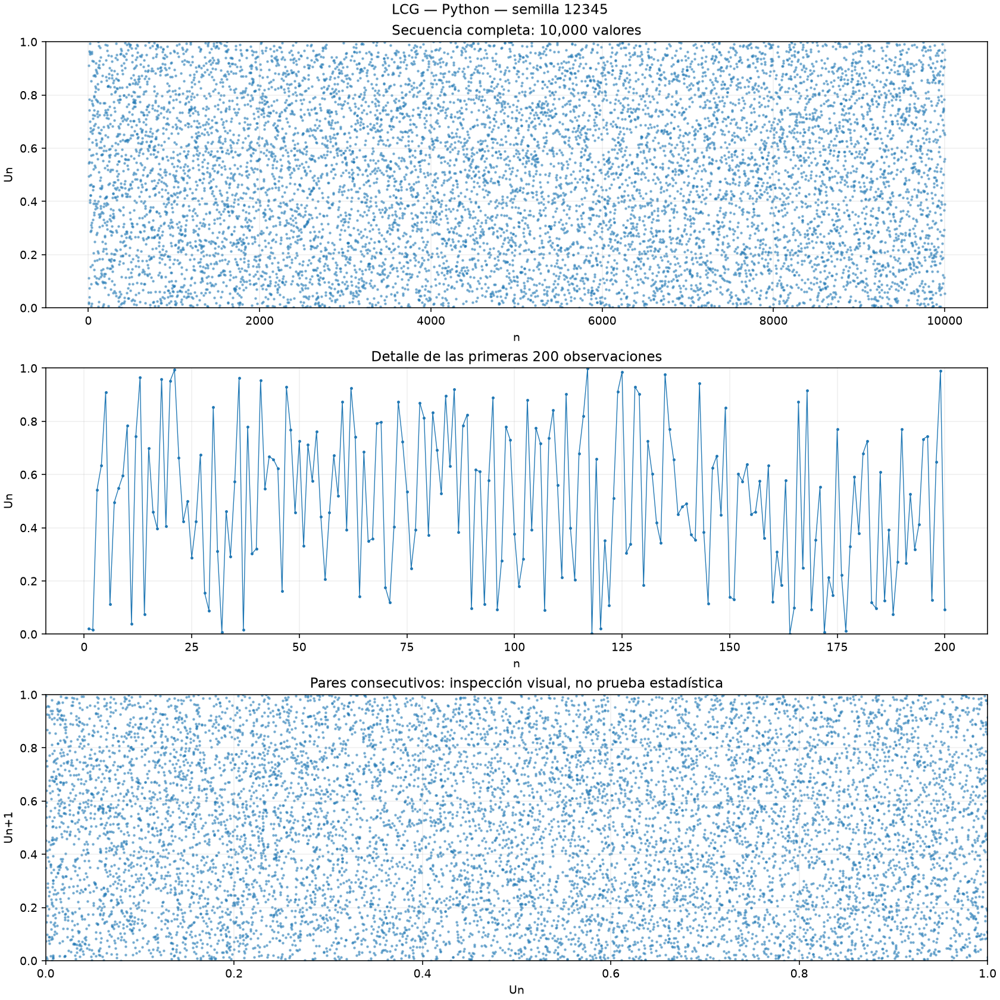
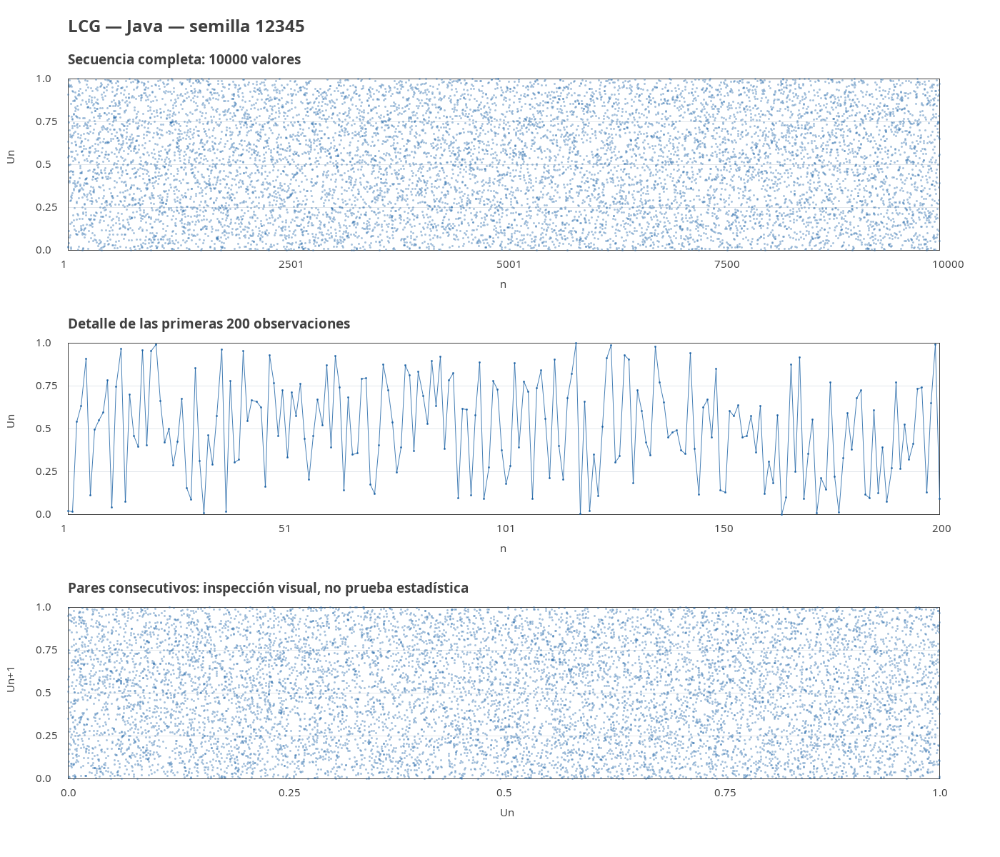
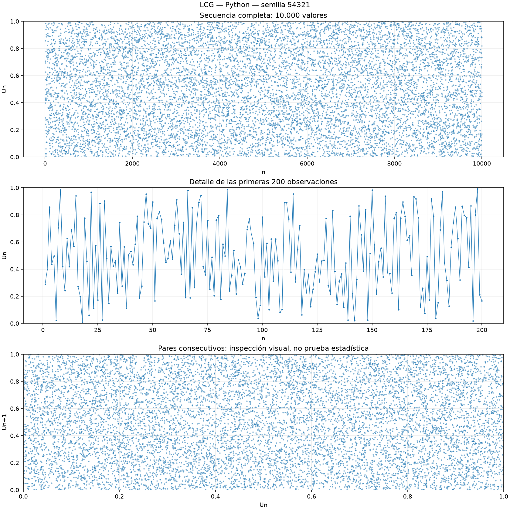
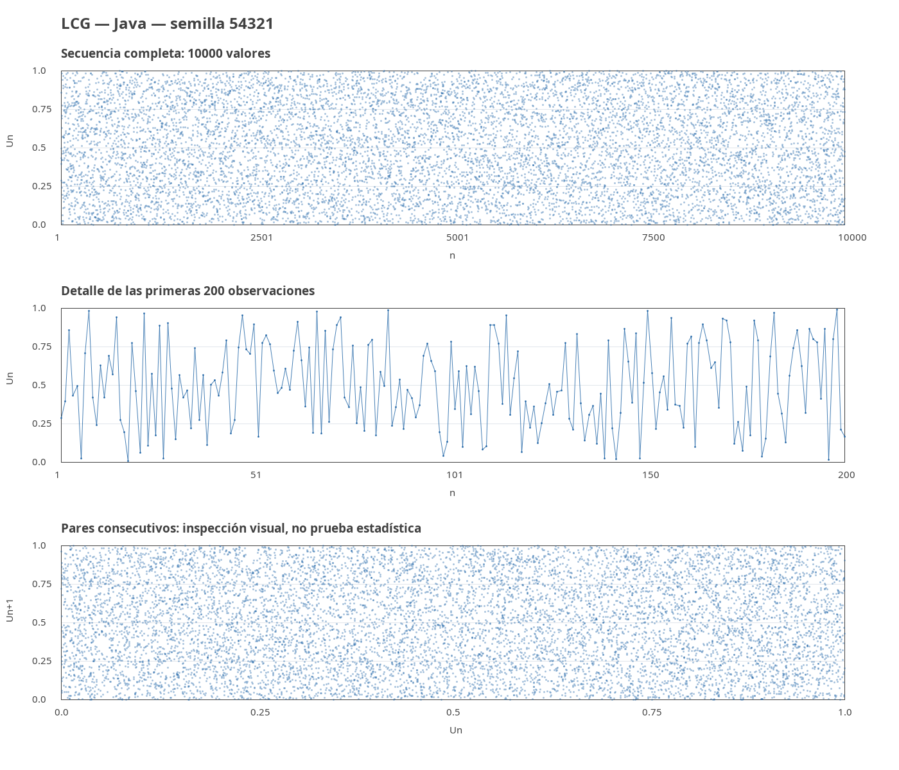

# Informe de resultados — APE 05: Generador Congruencial Lineal

Informe construido a partir de las salidas ejecutadas de Python y Java.

## Objetivo y método

Se implementó `X(n+1) = (a·X(n)+c) mod m`, con `Un = Xn/m`.
Parámetros: `a=1664525`, `c=1013904223`, `m=4294967296`; 10 000 salidas por lenguaje y semilla.
`X0` es la semilla; las salidas comienzan en `X1`. La segunda semilla `54321` es una elección del experimento; la guía solo solicita cambiarla.

## Comparación de las primeras 20 observaciones

Se verificó igualdad numérica exacta de enteros y normalizados en las 10 000 posiciones de cada semilla. Las tablas presentan las primeras 20 requeridas.
Aquí se muestran 12 decimales; los CSV conservan precisión de ida y vuelta.

### Semilla 12345

| n | Xn Python | Xn Java | Un Python | Un Java | Coinciden |
|---:|---:|---:|---:|---:|:---:|
| 1 | 87628868 | 87628868 | 0.020402685739 | 0.020402685739 | Sí |
| 2 | 71072467 | 71072467 | 0.016547848238 | 0.016547848238 | Sí |
| 3 | 2332836374 | 2332836374 | 0.543155794498 | 0.543155794498 | Sí |
| 4 | 2726892157 | 2726892157 | 0.634904056089 | 0.634904056089 | Sí |
| 5 | 3908547000 | 3908547000 | 0.910029513761 | 0.910029513761 | Sí |
| 6 | 483019191 | 483019191 | 0.112461669138 | 0.112461669138 | Sí |
| 7 | 2129828778 | 2129828778 | 0.495889405254 | 0.495889405254 | Sí |
| 8 | 2355140353 | 2355140353 | 0.548348844284 | 0.548348844284 | Sí |
| 9 | 2560230508 | 2560230508 | 0.596100117080 | 0.596100117080 | Sí |
| 10 | 3364893915 | 3364893915 | 0.783450416056 | 0.783450416056 | Sí |
| 11 | 171172990 | 171172990 | 0.039854317438 | 0.039854317438 | Sí |
| 12 | 3194601925 | 3194601925 | 0.743801222416 | 0.743801222416 | Sí |
| 13 | 4148119648 | 4148119648 | 0.965809367597 | 0.965809367597 | Sí |
| 14 | 316399679 | 316399679 | 0.073667540913 | 0.073667540913 | Sí |
| 15 | 3004788882 | 3004788882 | 0.699606929440 | 0.699606929440 | Sí |
| 16 | 1976948425 | 1976948425 | 0.460294174263 | 0.460294174263 | Sí |
| 17 | 1702883732 | 1702883732 | 0.396483515389 | 0.396483515389 | Sí |
| 18 | 4121112547 | 4121112547 | 0.959521286888 | 0.959521286888 | Sí |
| 19 | 1744294886 | 1744294886 | 0.406125301030 | 0.406125301030 | Sí |
| 20 | 4092090893 | 4092090893 | 0.952764156507 | 0.952764156507 | Sí |

### Semilla 54321

| n | Xn Python | Xn Java | Un Python | Un Java | Coinciden |
|---:|---:|---:|---:|---:|:---:|
| 1 | 1238253532 | 1238253532 | 0.288303366862 | 0.288303366862 | Sí |
| 2 | 1708513675 | 1708513675 | 0.397794338642 | 0.397794338642 | Sí |
| 3 | 3683344750 | 3683344750 | 0.857595528942 | 0.857595528942 | Sí |
| 4 | 1863498229 | 1863498229 | 0.433879492106 | 0.433879492106 | Sí |
| 5 | 2137457360 | 2137457360 | 0.497665572912 | 0.497665572912 | Sí |
| 6 | 102299631 | 102299631 | 0.023818488931 | 0.023818488931 | Sí |
| 7 | 3033777282 | 3033777282 | 0.706356317271 | 0.706356317271 | Sí |
| 8 | 4230855161 | 4230855161 | 0.985072730342 | 0.985072730342 | Sí |
| 9 | 1814797060 | 1814797060 | 0.422540367581 | 0.422540367581 | Sí |
| 10 | 1036872339 | 1036872339 | 0.241415654076 | 0.241415654076 | Sí |
| 11 | 2695818966 | 2695818966 | 0.627669265028 | 0.627669265028 | Sí |
| 12 | 1801476157 | 1801476157 | 0.419438853161 | 0.419438853161 | Sí |
| 13 | 2976955512 | 2976955512 | 0.693126467988 | 0.693126467988 | Sí |
| 14 | 2448971127 | 2448971127 | 0.570195523789 | 0.570195523789 | Sí |
| 15 | 4038571114 | 4038571114 | 0.940303111915 | 0.940303111915 | Sí |
| 16 | 1174362305 | 1174362305 | 0.273427531356 | 0.273427531356 | Sí |
| 17 | 849107756 | 849107756 | 0.197698305361 | 0.197698305361 | Sí |
| 18 | 33496219 | 33496219 | 0.007798946230 | 0.007798946230 | Sí |
| 19 | 3337365822 | 3337365822 | 0.777041032445 | 0.777041032445 | Sí |
| 20 | 1978253189 | 1978253189 | 0.460597963305 | 0.460597963305 | Sí |

## Estadísticas descriptivas

| Lenguaje | Semilla | Mínimo | Máximo | Media | Varianza poblacional |
|:---|---:|---:|---:|---:|---:|
| Python | 12345 | 0.0000590826 | 0.9999259654 | 0.4987698480 | 0.0830117668 |
| Java | 12345 | 0.0000590826 | 0.9999259654 | 0.4987698480 | 0.0830117668 |
| Python | 54321 | 0.0000783911 | 0.9998461837 | 0.4988696998 | 0.0835883281 |
| Java | 54321 | 0.0000783911 | 0.9998461837 | 0.4988696998 | 0.0835883281 |

Estas medidas describen la muestra; no constituyen pruebas de uniformidad ni de independencia.

## Cambio de semilla y observaciones

Cambiar de 12345 a 54321 modificó las 10000 observaciones en la misma posición. Python y Java continuaron coincidiendo exactamente.
Cada PNG muestra la secuencia completa, las primeras 200 salidas y los pares consecutivos `(Un, Un+1)` tratados en las diapositivas.
Los valores oscilan dentro de `[0,1)`. La dispersión visual de los pares no demuestra independencia; un período largo tampoco elimina las limitaciones del LCG.

## Análisis del período

Hull–Dobell, presentado en las diapositivas de la semana 5, garantiza período máximo del LCG mixto cuando se cumplen estas tres condiciones:

1. `gcd(c,m)=1`. Aquí `c=1013904223` es impar y `m=2^32`; son coprimos.
2. Todo factor primo de `m` divide a `a−1`. El único primo es 2 y `1664524` es par.
3. Si 4 divide a `m`, también divide a `a−1`. Se cumple `1664524 / 4 = 416131`.

Por tanto, **τ = m = 4 294 967 296**, para cualquier semilla válida de estos parámetros. La prueba es teórica: no se recorrieron cuatro mil millones de estados.

En cada experimento se revisaron `X0` y las 10 000 salidas sin detectar repetición. La longitud de muestra **no es** el período empírico. Para parámetros generales puede existir una etapa previa al ciclo: el analizador distingue esa etapa de la longitud del ciclo. Los casos de prueba pequeños verifican ambos escenarios.

Con período completo, las semillas 12345 y 54321 pertenecen al mismo ciclo, con distintos puntos de inicio. Cambiar de semilla no crea independencia garantizada ni mejora los parámetros.

## Preguntas de control

1. **¿Qué significa pseudoaleatorio?** Una secuencia producida por reglas deterministas que busca imitar propiedades del azar. Con estado inicial y parámetros se puede reproducir; su calidad requiere evaluación.
2. **¿Qué función cumple la semilla?** Es el estado inicial `X0`. Los mismos parámetros y la misma semilla producen exactamente la misma secuencia. Se inicializa una vez, antes del bucle.
3. **¿Qué significa período?** Es la longitud del ciclo de estados que se repite. En el generador de la guía, el ciclo incluye la semilla y τ es el menor entero positivo tal que `Xτ=X0`. Otros parámetros pueden tener una etapa previa al ciclo.
4. **¿Qué ocurre con parámetros inadecuados?** Pueden producir ciclos cortos, patrones geométricos y correlaciones que perjudican una simulación. No cumplir Hull–Dobell descarta período máximo del LCG mixto, pero no calcula automáticamente el período restante.
5. **¿Qué ventaja tiene usar dos lenguajes?** Verificar reproducibilidad y detectar errores de índices, normalización, tipos numéricos o desbordamiento. La coincidencia comprueba implementación; no demuestra calidad estadística.

## Conclusiones

1. Las implementaciones reprodujeron exactamente 10 000 estados y sus normalizados por semilla, con dos semillas, cumpliendo la comparación entre Python y Java.
2. Hull–Dobell permite justificar el período completo sin recorrerlo; el análisis empírico se limita a la muestra realmente observada.
3. Cambiar la semilla modifica el inicio y las observaciones, mientras conserva el período garantizado por los parámetros.
4. La práctica permite estudiar determinismo y reproducibilidad. El período máximo no elimina los hiperplanos, la correlación de bits bajos ni la predictibilidad tratados en clase. El LCG no es apropiado para criptografía; las pruebas estadísticas formales se desarrollan en la semana 6.

## Fuentes y alcance

- `ape_guia simulacion semana 5.pdf`, pp. 1–2: objetivos, parámetros, procedimiento, resultados y preguntas.
- `simulacion Semana 5.pptx [Repaired].pdf`, pp. 6–10, 14–15 y 19–20: determinismo, LCG, Hull–Dobell, limitaciones y errores comunes.
- La guía de la práctica tiene prioridad para elegir parámetros. Las diapositivas complementan la explicación; su ejemplo MINSTD no sustituye el LCG solicitado.
- Los casos pequeños de las pruebas son recursos de verificación del software; no reemplazan los experimentos de 10 000 valores.

