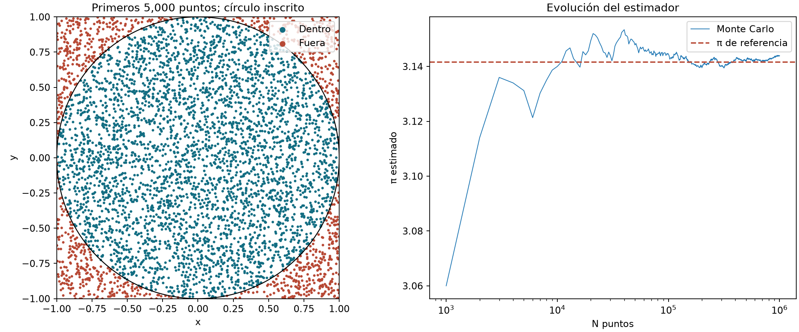
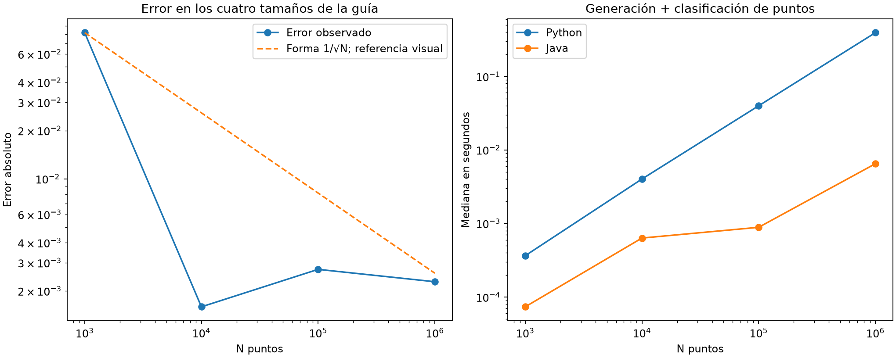

Reporte Técnico de Actividades
Práctico-Experimentales Nro. 007

## 1. Datos de Identificación del Estudiante y la Práctica

| Nombre del estudiante | Anderson Mateo Coello Jaramillo |
| --- | --- |
| Asignatura | Simulación |
| Ciclo | 5 |
| Unidad | U2: Generación de números pseudoaleatorios y generación de variables aleatorias |
| Resultado de aprendizaje de la unidad | R2. Interpreta los resultados de una Simulación, bajo los principios de solidaridad, transparencia, responsabilidad y honestidad. |
| Práctica Nro. | 007 |
| Título de la Práctica | Estimación de resultados mediante el método de Monte Carlo |
| Nombre del Docente | José O. Guamán Q. |
| Fecha de la práctica | 12 de noviembre de 2026 / 13 de noviembre de 2026 |
| Horario | Jueves 10h30 a 11h30 / Viernes 07h30 a 09h30 |
| Lugar | Aula |
| Tiempo planificado en el Sílabo | 3 horas |

## 2. Objetivo(s) de la Práctica

Aplicar el método de Monte Carlo para obtener aproximaciones numéricas mediante experimentos aleatorios [1].

1. Implementar un experimento Monte Carlo.

2. Analizar la influencia del tamaño de muestra sobre el error.

3. Comparar resultados obtenidos en Python y Java.

## 3. Materiales y reactivos

Utilicé un computador, Python, Java/JDK, un entorno de desarrollo y un generador pseudoaleatorio. La fuente principal fue la guía firmada de la práctica 07 [1]; conservé su documento original.

## 4. Equipos y herramientas

| Herramienta | Uso y versión registrados |
| --- | --- |
| Sistema | Linux-7.0.0-43-generic-x86_64-with-glibc2.43 |
| Python | 3.14.4; entorno .venv local de 07APE |
| Java | 21.0.13.0.3; JDK y compilación Maven con release 21 |
| Cálculo y tablas | NumPy 2.5.4; Pandas 3.1.1 |
| Visualización y documento | Matplotlib 3.11.2; ReportLab 5.1.0 |
| Verificación | unittest, diez campañas QA; JUnit 5.12.2, diez pruebas del modelo Java |

## 5. Procedimiento / Metodología Ejecutada

## 5.1. Modelo matemático

Generé puntos en el cuadrado [-1,1)², de área 4, y conté los que satisfacen x² + y² ≤ 1, incluyendo la frontera del círculo de radio 1. Su área es π; la proporción interior aproxima π/4 [1].

x = 2U1 − 1; y = 2U2 − 1
π estimado = 4Nc/N    Error = |π estimado − π|

N cuenta puntos, no números del generador: cada punto consume dos valores consecutivos. Trabajé con N = 1000, 10000, 100000 y 1000000, exactamente los tamaños de la guía.

## 5.2. Generación y reproducibilidad

Elegí el LCG MINSTD utilizado como referencia en el proyecto anterior: a=16807, c=0, m=2147483647 y semilla=123457. La guía 07 no impone estos valores. Inicialicé una sola vez por experimento y normalicé mediante división real; no sustituí el LCG por random o Math.random().

Los cuatro tamaños utilizan prefijos de la misma secuencia. No los considero muestras independientes. La exportación binaria permite contrastar los 2000000 estados que forman el millón de puntos.

## 5.3. Arquitectura MVC y patrón Strategy

| Componente | Responsabilidad |
| --- | --- |
| Modelo | Parámetros, LCG, estimación de π y medición de tiempos; sin archivos ni gráficas. |
| Vista | Presentación en consola y exportación CSV, JSON y secuencia binaria. |
| Controlador | Valida tamaños y coordina modelo/vista en ambos lenguajes. |
| Strategy | EstimadorPi recibe FuenteUniforme. En producción usa GeneradorLCG y en pruebas fuentes controladas para verificar casos geométricos exactos. |

Elegí Strategy porque permite cambiar y probar la fuente sin modificar el criterio del círculo. La inyección de dependencias y los objetos de resultado separan responsabilidades sin añadir un framework.

## 5.4. Protocolo de ejecución y medición

1. Ejecuté el mismo experimento en Python y Java con idénticos parámetros y operaciones.

2. Realicé tres calentamientos de hasta 10000 puntos y cinco mediciones por tamaño; cada medición reinició la semilla.

3. Medí generación y clasificación de puntos con perf_counter y System.nanoTime. Excluí compilación, calentamientos, archivos, gráficas y comparación.

4. Publiqué las medianas y conservé los cinco tiempos individuales por caso: veinte por lenguaje.

5. Comprobé cada estado contra la recurrencia; reconstruí puntos y conteos para los cuatro N. Verifiqué además hashes, tablas iniciales, estimaciones, errores, medianas y mínimos.

## 5.5. Ejecución reproducible

Desde 07APE, preparé el entorno, ejecuté los experimentos y comprobé la entrega:

```text
bash scripts/preparar.sh
bash scripts/ejecutar.sh
bash scripts/verificar.sh
.venv/bin/python scripts/generar_informe.py
.venv/bin/python scripts/generar_video.py
```

Las repeticiones miden rendimiento del mismo experimento; no representan cinco réplicas estadísticas independientes. Repetir la ejecución reemplaza los resultados con los mismos nombres.

## 6. Resultados Obtenidos

## 6.1. Tabla solicitada en la guía

| N | π estimado | Error absoluto | Tiempo Python (s) | Tiempo Java (s) |
| --- | --- | --- | --- | --- |
| 1 000 | 3.06000000 | 0.08159265 | 0.00036424 | 0.00007351 |
| 10 000 | 3.14000000 | 0.00159265 | 0.00402105 | 0.00063327 |
| 100 000 | 3.14432000 | 0.00272735 | 0.03984748 | 0.00088667 |
| 1 000 000 | 3.14387600 | 0.00228335 | 0.39313000 | 0.00649209 |

Tabla 1. Medianas de cinco mediciones. Fuente: resultados/comparacion/tabla_guia.csv; los tiempos individuales constan en resultados/python/tiempos.csv y resultados/java/tiempos.csv.

| N | Nc Python | Nc Java | Coincidencia |
| --- | --- | --- | --- |
| 1 000 | 765 | 765 | Exacta |
| 10 000 | 7 850 | 7 850 | Exacta |
| 100 000 | 78 608 | 78 608 | Exacta |
| 1 000 000 | 785 969 | 785 969 | Exacta |

Tabla 2. Conteos reconstruidos a partir de los estados originales. Se comparó un millón de puntos y dos millones de estados; no únicamente los primeros valores visibles.

## 6.2. Comparación de los primeros diez puntos

| Punto | x Python | x Java | y Python | y Java | Interior |
| --- | --- | --- | --- | --- | --- |
| 1 | 0.932440 | 0.932440 | -0.478578 | -0.478578 | No |
| 2 | 0.532524 | 0.532524 | 0.138674 | 0.138674 | Sí |
| 3 | 0.689658 | 0.689658 | -0.911467 | -0.911467 | No |
| 4 | 0.974368 | 0.974368 | 0.202701 | 0.202701 | Sí |
| 5 | 0.792751 | 0.792751 | -0.238292 | -0.238292 | Sí |
| 6 | -0.968039 | -0.968039 | 0.174093 | 0.174093 | Sí |
| 7 | -0.022530 | -0.022530 | -0.661901 | -0.661901 | Sí |
| 8 | -0.573845 | -0.573845 | -0.606463 | -0.606463 | Sí |
| 9 | -0.820980 | -0.820980 | -0.210050 | -0.210050 | Sí |
| 10 | -0.308010 | -0.308010 | -0.715765 | -0.715765 | Sí |

Tabla 3. Coordenadas redondeadas solo para lectura. Los CSV conservan las veinte observaciones iniciales y el binario todos los estados. En este módulo las divisiones no son generalmente exactas en binario, pero ambos lenguajes ejecutan las mismas operaciones binary64.

## 6.3. Visualización y análisis del tamaño de muestra



## 1. ¿Cómo cambia la estimación de π cuando aumenta el número de puntos?

Obtuve 3.06, 3.14, 3.14432 y 3.143876. La aproximación oscila alrededor del valor de referencia. El mayor tamaño mejora respecto a 1000 puntos, pero no es el mejor de los cuatro casos.

## 2. ¿Qué relación existe entre el tamaño de muestra y el error absoluto?

En el modelo ideal de puntos uniformes independientes, la desviación estándar escala como 1/√N. Es una tendencia del muestreo; el error absoluto de una trayectoria puede aumentar entre dos tamaños. Aquí aumentó al pasar de 10000 a 100000 puntos.

## 3. ¿En cuál de los tamaños de muestra se obtuvo una mejor aproximación de π?

La menor diferencia observada correspondió a N=10 000, con π estimado=3.14000000 y error=0.00159265. La conclusión se limita a esta semilla y los tamaños evaluados.

## 6.4. Error, tiempos y discusión



## 4. ¿Qué lenguaje presentó menor tiempo de ejecución?

Java registró menor mediana en los cuatro tamaños. El resultado corresponde a estas implementaciones, relojes y entorno; no establece una superioridad universal.

## 5. ¿Por qué los resultados obtenidos en Python y Java pueden ser diferentes?

Pueden cambiar si difieren el generador, la semilla, el orden de consumo, la normalización o las operaciones numéricas. En mi implementación coincidieron los estados, los puntos, los conteos y π; los tiempos fueron diferentes.

## 6. ¿Qué importancia tiene la generación de números pseudoaleatorios en el método Monte Carlo?

La distribución y las dependencias de los puntos afectan la estimación. Usar una fuente reproducible permite contrastar programas; obtener la misma secuencia no demuestra calidad estadística ni independencia.

## 7. ¿El aumento del número de puntos garantiza que cada ejecución obtenga un resultado más cercano al valor real?

No. La reducción del error es una tendencia de muestreo, no una garantía para cada ejecución. Los resultados de 10000 y 100000 puntos muestran esa diferencia.

## 8. ¿Qué aplicaciones reales puede tener el método Monte Carlo en ingeniería, economía, informática y ciencias?

Puede emplearse en análisis de confiabilidad, evaluación de riesgo, integración numérica y estudio de sistemas con incertidumbre. Son aplicaciones posibles; en esta práctica implementé la estimación de π.

## 7. Preguntas de Control

## 1. ¿Qué es Monte Carlo?

Es un método que aproxima cantidades mediante muestreo y experimentos aleatorios o pseudoaleatorios. Aquí aproximé π usando la proporción de puntos dentro del círculo.

## 2. ¿Por qué el error disminuye al aumentar las muestras?

Bajo los supuestos de muestreo ideal, la proporción observada se estabiliza y su variabilidad disminuye como 1/√N. Esto no obliga al error absoluto de cada prefijo a disminuir y no demuestra que el LCG produzca puntos independientes.

## 3. ¿Qué relación existe entre precisión y costo computacional?

Procesar más puntos requiere más operaciones. El cálculo tiene costo O(N); para reducir aproximadamente a la mitad la desviación estándar ideal se necesitan cuatro veces los puntos. La exportación completa también ocupa O(N).

## 4. ¿Qué diferencias se observaron entre Python y Java?

Los resultados numéricos coincidieron exactamente. Java registró menor mediana en los cuatro tamaños. Medí solo generación y clasificación, excluyendo archivos y gráficas.

## 5. ¿En qué otros problemas puede utilizarse Monte Carlo?

En integración y estimación de probabilidades, propagación de incertidumbre, confiabilidad y evaluación de escenarios. Cada aplicación requiere un modelo y supuestos adecuados; no se ejecutaron esos modelos adicionales en este APE.

## 8. Conclusiones

1. Implementé la estimación Monte Carlo con círculo inscrito en Python y Java. Verifiqué la igualdad de dos millones de estados y un millón de puntos, junto con los cuatro conteos y estimaciones.

2. La mejor aproximación de esta ejecución se obtuvo con 10 000 puntos. El error no disminuyó de forma monótona, de acuerdo con la naturaleza del estimador.

3. Java registró menor mediana en los cuatro tamaños. Los datos originales y el protocolo permiten interpretar esa medición con sus límites.

## 9. Verificación y diez campañas de QA

| Nro. | Campaña realizada | Resultado |
| --- | --- | --- |
| 01 | Vector conocido, semillas extremas y rango de 10000 valores | Aprobada |
| 02 | Centro, frontera, esquina y consumo exacto de 2N valores | Aprobada |
| 03 | Semillas, tamaños y fuentes inválidas; NaN e infinito | Aprobada |
| 04 | Reproducibilidad de 20000 estados con tres semillas | Aprobada |
| 05 | Catorce entradas CLI adversarias en ambos lenguajes | Aprobada |
| 06 | Integración real, N=1 y rutas con espacios | Aprobada |
| 07 | Estado alterado con hash actualizado y archivo truncado | Aprobada |
| 08 | π, conteos, medianas, tiempos y coordenadas adulterados | Aprobada |
| 09 | Ruta de salida inválida y medianas pares/impares | Aprobada |
| 10 | Millón de puntos con semilla límite y comparación completa | Aprobada |

Tabla 4. Diez campañas unittest con subcasos adversarios. Java añade diez pruebas JUnit del modelo. Ninguna integración se contó como omitida. Evidencia: resultados/revision/qa.log y java.log.

```text
Python: Ran 10 tests; OK
Java: Tests run: 10, Failures: 0, Errors: 0, Skipped: 0
Comparación: 2000000 estados; 1000000 puntos; igualdad exacta
```

## 9.1. Cuatro análisis realizados

1. Lectura de la guía firmada, requisitos, preguntas y contradicciones de la rúbrica.

2. Validación del modelo geométrico, consumo de números, arquitectura y protocolo de tiempos.

3. Pruebas adversarias e integración real, incluyendo adulteración de resultados y carga máxima.

4. Revisión final de datos, documento, gráficas, video y trazabilidad de archivos.

Los documentos ANALISIS_01 a ANALISIS_04 de docs conservan el alcance y las evidencias de cada revisión.

## 10. Bibliografía, anexos y alcance de la entrega

[1] Guamán Q., José O. Guía de Actividades Práctico-Experimentales Nro. 007: Estimación de resultados mediante el método de Monte Carlo. Simulación, ciclo 5, U2; 12 y 13 de noviembre de 2026. Archivo: ape_guia simulacion semana 7-signed.pdf, pp. 1–4.

[2] Material de la asignatura. Semana 6: Pruebas estadísticas de uniformidad e independencia. Referencia bibliográfica indicada por la guía 07. Se consultaron las páginas 19–20 como contexto de interpretación y limitaciones; no sustituyen el modelo Monte Carlo de la guía firmada.

[3] Proyecto 07APE: código Python/Java, tablas y secuencias originales, registros QA y cuatro análisis documentados. Parámetros MINSTD contrastados con el material de referencia utilizado en APE 06; su elección y la semilla se declaran como decisiones del experimento.

## 10.1. Archivos para revisar y demostrar

| Archivo o carpeta | Contenido |
| --- | --- |
| APE07-CoelloAnderson-U2-Simulacion.pdf | Informe académico; versión editable Markdown con igual nombre. |
| resultados/comparacion/tabla_guia.csv | Cuatro filas con π, error y tiempos de ambos lenguajes. |
| resultados/python y resultados/java | Secuencias completas, primeras observaciones, resúmenes y tiempos originales. |
| resultados/comparacion | Gráficas, convergencia, comparación inicial y verificacion.json. |
| evidencias/APE07-demostracion.mp4 | Video generado desde los resultados reales; sin narración personal. |
| docs/DEFENSA.md | Guion de explicación y comandos para la demostración en vivo. |

## 10.2. Alcance confirmado y defensa oral

Los objetivos y todo el procedimiento de la guía corresponden a Monte Carlo para π, pero la rúbrica menciona «modelo M/M/1». El docente confirmó que la práctica corresponde a Monte Carlo, según lo comunicado por el estudiante el 12 de noviembre de 2026. La implementación de π sigue ese alcance confirmado; la discrepancia del documento original queda registrada.

La rúbrica distribuye 4 puntos en defensa/demostración, 3 en implementación y 3 en documento/evidencias, incluido video. El archivo de video muestra resultados verificados y sirve como evidencia complementaria; la defensa oral y el dominio personal del código deben demostrarse ante el docente.

El documento firmado permanece intacto. La identidad y el formato institucional se verificaron con el reporte APE 06; el contenido, los resultados y las fechas pertenecen a esta práctica 07.
