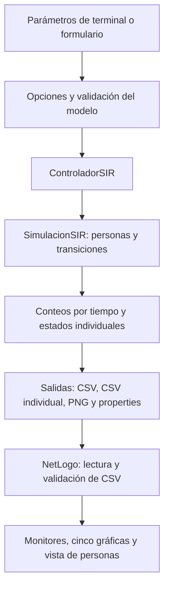

**Guía de estudio y guion de video del APE04.** Esta explicación se basa en el código fuente actual, el `pom.xml`, los módulos NetLogo y los archivos de ejemplo del proyecto. Para prepararla se inspeccionaron los archivos; no se ejecutaron Maven, las pruebas ni una nueva simulación. Los resultados numéricos citados pertenecen al CSV de ejemplo existente.

La idea que debes poder explicar con tus palabras es esta:

> Java calcula cómo cambian los estados de una población. Guarda los resultados en archivos. NetLogo lee esos archivos, los valida y reproduce sus datos con gráficas y figuras de personas.

**Comprende primero qué significa SIR.** Cada persona tiene uno de tres estados:

| Estado | Significado dentro del programa |
|---|---|
| S: susceptible | Puede infectarse. |
| I: infectado | Puede contagiar y puede recuperarse. |
| R: recuperado | Ya no contagia y permanece recuperado en esta simulación. |

Las transiciones del motor son `S → I → R`. La población es cerrada: sus miembros permanecen en ella y cambian de estado. Por eso se conserva `S + I + R = N`.

Con los valores iniciales, hay 100 personas: 95 susceptibles, 5 infectadas y 0 recuperadas. Después de un paso podrían cambiar los conteos, pero su suma sigue siendo 100.

El programa representa personas individuales, utiliza sorteos y avanza por pasos. Puedes describirlo como un modelo SIR individual, estocástico y de tiempo discreto. Estocástico significa que interviene el azar; tiempo discreto significa que se pasa de t=0 a t=1, después a t=2, etc. El código no asigna una duración física a un paso: en la exposición di «pasos», sin convertirlos automáticamente en días.

**Los parámetros indican qué escenario se calcula.**

| Parámetro | Valor inicial | Explicación sencilla |
|---|---:|---|
| Población | 100 | Cuántas personas existen. |
| Infectados iniciales | 5 | Cuántas comienzan infectadas; las demás comienzan susceptibles. |
| Beta | 0.30 | Probabilidad de contagio por intento de contacto con alguien susceptible al comienzo del paso. |
| Gamma | 0.10 | Probabilidad de recuperación por paso para una persona que ya estaba infectada al comenzar ese paso. |
| Pasos | 100 | Cuántos avances calcula el motor después de registrar t=0. |
| Contactos | 1 | Cuántas personas selecciona aleatoriamente cada infectado por paso. |
| Semilla | 42 | Número que fija la secuencia de sorteos para reproducir una trayectoria con la misma configuración. |

Beta=0.30 no obliga a infectar al 30 % de la población. Un infectado selecciona un contacto; si ese contacto era susceptible, se realiza un sorteo de contagio con probabilidad 0.30. El número total de contagios cambia según los contactos elegidos, los estados y los sorteos.

Gamma=0.10 tampoco obliga a recuperar exactamente al 10 % de los infectados en cada paso: cada infectado del inicio del paso tiene su propio sorteo.

La semilla no representa personas ni probabilidades. Con la misma semilla, los mismos parámetros y esta implementación se repite la trayectoria. Los nombres automáticos de archivo y el tiempo medido pueden diferir entre ejecuciones, aunque la trayectoria sea la misma.

**Ubica las carpetas antes de entrar al código.** Una carpeta organiza archivos. Un paquete Java agrupa clases relacionadas y aparece al comienzo del archivo, por ejemplo `package sir.model;`. Una clase define una pieza del programa; sus atributos guardan datos y sus métodos realizan acciones. Un objeto es una instancia concreta de una clase, como una persona creada a partir de `Individuo`.

```text
04APE_Grupal/
├── src/
│   ├── main/java/sir/
│   │   ├── Main.java
│   │   ├── Opciones.java
│   │   ├── LanzadorNetLogo.java
│   │   ├── model/
│   │   ├── controller/
│   │   ├── io/
│   │   └── view/
│   └── test/java/sir/pruebas/
├── netlogo/
│   ├── modelo_sir_netlogo.nlogox
│   ├── datos.nls
│   ├── individuos.nls
│   ├── personas.nls
│   ├── vista.nls
│   ├── controlador.nls
│   └── datos/
├── resultados/
├── pruebas/verificar.sh
├── .mvn/wrapper/maven-wrapper.properties
├── mvnw
├── mvnw.cmd
├── pom.xml
├── README.md
└── target/
```

| Carpeta o archivo | Para qué sirve |
|---|---|
| `src/main/java/` | Código Java de la aplicación. |
| `sir/model/` | Personas, estados, parámetros, resultados y reglas de la simulación. |
| `sir/controller/` | Coordinación de la ejecución y sus cuatro salidas. |
| `sir/io/` | Entrada y salida de archivos: escribir, leer y validar. `io` significa input/output. |
| `sir/view/` | Ventana, gráfica Java y comunicación con la representación NetLogo. |
| `src/test/java/sir/pruebas/` | Comprobaciones automáticas del programa. |
| `netlogo/` | Fuente del modelo visual y sus módulos. |
| `netlogo/datos/` | Archivos de los escenarios: CSV, parámetros e imágenes generadas. |
| `resultados/` | Capturas de la vista NetLogo y una imagen de comparación incluida. |
| `pruebas/verificar.sh` | Atajo Bash para ejecutar los comandos de validación Maven. |
| `.mvn/wrapper/` | Configuración del Maven Wrapper; fija Maven 3.9.12. |
| `mvnw` y `mvnw.cmd` | Lanzadores del Maven del proyecto para Linux/macOS y Windows. |
| `pom.xml` | Receta de construcción: Java 21, plugins, pruebas y JAR con entrada `sir.Main`. |
| `target/` | Salidas generadas por Maven: clases compiladas, `sir.jar` e informes. Se regenera a partir del código fuente. |
| `README.md` | Documentación del proyecto. |
| PDF de la guía | Documento académico incluido con la práctica. |
| `.gitignore` | Indica a Git qué resultados, reservas y temporales omitir del seguimiento. |

Si aparecen `.git/` o `.github/`, son auxiliares del repositorio y sus herramientas. Los scripts de `.github/modernize/java-upgrade/` no intervienen en las reglas SIR ni en el arranque normal. Si ves un `sir.jar` en la raíz, utiliza el artefacto definido actualmente en Maven: `target/sir.jar`.

**La arquitectura separa responsabilidades.** Puedes describirla como una organización inspirada en MVC: modelo, vista y controlador, acompañados de una parte de entrada/salida.

| Parte | Pregunta que resuelve | Ejemplo |
|---|---|---|
| Modelo | ¿Cómo cambian las personas? | Decidir si un contacto causa contagio. |
| Controlador | ¿Qué tareas hay que coordinar para obtener una ejecución? | Crear el modelo, avanzar, exportar y generar la gráfica. |
| Entrada/salida | ¿Cómo se guardan y comprueban los datos? | Escribir un CSV y comprobar que sus filas son coherentes. |
| Vista | ¿Cómo ve y maneja los resultados el usuario? | Botones, monitores, curvas y personas coloreadas. |

Separar responsabilidades permite localizar un cambio: las probabilidades se implementan en el modelo; el formato de los archivos se atiende en entrada/salida; un botón pertenece a la ventana. El controlador conecta estas piezas.

Es una descripción útil del diseño existente. El controlador también utiliza `GraficaSIR`, que pertenece a `view`, para producir el PNG; por eso conviene hablar de organización inspirada en MVC sin presentar una separación absoluta entre todas las clases.



**El arranque se entiende siguiendo `Main.java`.** Al ejecutar:

```bash
java -jar target/sir.jar
```

el manifiesto del JAR indica a Java que entre en `sir.Main`. Dentro de su método `main` sucede lo siguiente:

1. Atiende la opción de ayuda cuando se solicita.
2. Localiza la raíz del proyecto, buscando `pom.xml` y el modelo NetLogo a partir de la ubicación del artefacto.
3. Lee los argumentos mediante `Opciones.leer`.
4. Ejecuta `ControladorSIR` con los parámetros, semilla y ruta de salida.
5. Imprime ruta CSV, estado final, pico de infectados y R0 nominal.
6. Abre el visor si se pidió la ejecución gráfica.

La llamada que inicia el trabajo está en `Main.java:18`:

```java
var serie = new ControladorSIR(new ExportadorCsv())
        .ejecutar(opciones.parametros(), opciones.semilla(), opciones.csv());
```

Se crea un controlador, se le entrega un exportador CSV y se le pide ejecutar. `serie` contiene los conteos de todos los instantes. NetLogo se abre después de esta llamada, en `Main.java:34`.

`Opciones.java` convierte textos como `--beta 0.10` en valores utilizables por Java. Detecta opciones desconocidas, repetidas y valores faltantes. Para los valores numéricos del modelo construye un `ParametrosSIR`, que comprueba los rangos.

`LanzadorNetLogo.java` busca la instalación de NetLogo 7.0.4 y abre otro proceso Java para la ventana integrada, incluyendo las bibliotecas instaladas de NetLogo. Puede usar una ruta explícita, `NETLOGO_HOME`, el ejecutable en `PATH` o carpetas habituales. Las bibliotecas de NetLogo se obtienen de la instalación local.

**Ahora relaciona cada clase del modelo con una idea sencilla.**

| Clase | Función |
|---|---|
| `Estado` | Enumera los estados permitidos: `SUSCEPTIBLE`, `INFECTADO`, `RECUPERADO`. Un `enum` establece una lista cerrada de opciones. |
| `Individuo` | Guarda un ID estable y un estado que puede cambiar. Por ejemplo, persona 7, estado infectado. |
| `ParametrosSIR` | Guarda configuración válida. Rechaza población imposible, probabilidades fuera de rango y escenarios demasiado grandes. |
| `ResultadoPaso` | Guarda una fotografía resumida: tiempo, número de susceptibles, infectados y recuperados. |
| `SimulacionSIR` | Crea la población, selecciona infectados iniciales, realiza contactos y recuperaciones y devuelve los conteos. |

Al crear `SimulacionSIR`, se construyen N individuos susceptibles con IDs de 0 a N−1. Después se eligen personas al azar hasta completar la cantidad inicial de infectados. Un ID elegido dos veces no se cuenta como dos personas.

Los métodos que más conviene mostrar son:

| Método | Qué hace |
|---|---|
| `crearPoblacion()` | Crea las personas. |
| `seleccionarInfectadosIniciales()` | Cambia los infectados iniciales elegidos al azar. |
| `contarPoblacion()` | Cuenta los estados y crea un `ResultadoPaso`. |
| `paso()` | Ejecuta un avance de la simulación. |
| `getPoblacion()` | Entrega una copia de las personas para consultar/exportar sus estados sin exponer directamente la lista real del modelo. |

**El método `paso()` contiene la lógica más importante.** Está en `src/main/java/sir/model/SimulacionSIR.java:67`.

Su funcionamiento puede explicarse así:

```text
Copiar los estados que existen al comenzar el paso.
Recorrer las personas que estaban infectadas en esa copia.
Para cada una:
    Elegir aleatoriamente sus contactos.
    Si un contacto era susceptible y el sorteo es menor que beta:
        Cambiar ese contacto a infectado.
    Sortear si el infectado original se recupera usando gamma.
Aumentar el tiempo en uno.
Contar S, I y R y devolver el resultado.
```

El contagio se implementa con estas instrucciones:

```java
int contacto = aleatorio.nextInt(poblacion.size());
if (copia[contacto] == Estado.SUSCEPTIBLE
        && aleatorio.nextDouble() < parametros.getBeta()) {
    poblacion.get(contacto).setEstado(Estado.INFECTADO);
}
```

`nextInt` elige un ID de toda la población. `nextDouble` produce un valor desde 0 incluido hasta 1 excluido. Si ese valor es menor que beta y el contacto era susceptible al inicio del paso, ocurre el contagio.

El infectado también puede recuperarse:

```java
if (aleatorio.nextDouble() < parametros.getGamma()) {
    poblacion.get(i).setEstado(Estado.RECUPERADO);
}
```

La copia del comienzo del paso es esencial. Imagina que Ana ya estaba infectada y Bruno era susceptible. Si Ana contagia a Bruno durante este avance, Bruno podrá contagiar y recuperarse a partir del avance siguiente. Así se evita que una cadena de nuevos contagios recorra la población dentro del mismo paso simplemente por el orden del bucle. Ana sí puede contagiar y recuperarse durante ese avance.

Los contactos se eligen de toda la población. Pueden seleccionar a un infectado, a un recuperado o al propio infectado que actúa; también pueden repetirse. La elección se hace por azar y no consulta distancias ni posiciones de NetLogo.

**El controlador convierte una simulación en una ejecución con resultados.** `ControladorSIR.ejecutar` recibe la configuración, semilla y destino CSV. Comprueba las rutas, reserva los nombres con archivos `.lock` y rechaza sobrescribir salidas existentes. Después prepara archivos temporales y crea el motor.

Registra t=0, llama a `paso()` tantas veces como se haya solicitado y va escribiendo los estados individuales. Al terminar, exporta los conteos, crea el PNG y escribe los parámetros. Publica el CSV agregado al final. Si ocurre un fallo ordinario, intenta retirar sus propias salidas parciales y limpiar los temporales.

Con 100 pasos hay 101 instantes guardados: el inicio más los cien avances. Para 100 personas se obtienen 10 100 filas individuales de datos, además del encabezado.

El contador `modelo_ms` acumula el tiempo de contar y avanzar el modelo. No equivale al tiempo total de inicio, exportación, apertura de NetLogo y reproducción.

**La entrada/salida permite guardar y revisar lo calculado.**

| Clase de `io/` | Responsabilidad |
|---|---|
| `ExportadorResultados` | Interfaz: acuerdo que exige saber exportar una lista de resultados a una ruta. |
| `ExportadorCsv` | Implementación que escribe el CSV agregado con una fila por instante. |
| `ExportadorIndividuos` | Escribe por pasos las filas con tiempo, ID y estado de cada persona. |
| `LectorCsv` | Lee el agregado y valida encabezado, tiempos, conteos y evolución de las cantidades. |
| `LectorIndividuos` | Busca el archivo individual compañero y revisa identidades, estados, transiciones y coincidencia con el agregado. |
| `HuellasArchivos` | Calcula SHA-256 para detectar modificaciones o mezclas del contenido cuando se comparan sus huellas. |

Una interfaz es un acuerdo que otras clases cumplen. Aquí `ExportadorResultados` permite que el controlador reciba un exportador mediante ese acuerdo; `ExportadorCsv` es la implementación utilizada. Para exponer basta explicar que la coordinación y el formato de escritura tienen responsabilidades separadas.

Para una ruta `escenario.csv`, la ejecución actual genera cuatro archivos:

| Archivo | Contenido y uso |
|---|---|
| `escenario.csv` | Conteos S/I/R por tiempo; alimenta las curvas y monitores. |
| `escenario_individuos.csv` | Estado de cada ID en cada instante; alimenta las figuras de personas. |
| `escenario.png` | Gráfica de toda la trayectoria dibujada por Java. |
| `escenario.properties` | Parámetros, semilla, tiempo medido y huellas SHA-256 de los CSV. |

El agregado incluido empieza así:

```csv
tiempo,susceptibles,infectados,recuperados
0,95,5,0
1,93,7,0
```

La segunda fila de datos significa: al llegar a t=1 hay 93 susceptibles, 7 infectados y 0 recuperados. Su suma sigue siendo 100.

El formato individual tiene este encabezado:

```csv
tiempo,id,estado
```

Una fila hipotética `3,7,INFECTADO` significaría «en el paso 3, la persona con ID 7 está infectada». Esta fila ilustra el formato; no se presenta como un registro comprobado de los archivos de ejemplo.

El estado individual se escribe progresivamente al disco. El archivo sí guarda todos los pasos, pero el programa evita conservar todo el historial individual simultáneamente en memoria.

**La vista Java tiene tres piezas distintas.**

`VentanaSimulacion.java` construye la ventana Swing: campos de entrada, botones, barra de velocidad, mensajes y área con el componente NetLogo. También atiende acciones como generar otra ejecución o elegir archivos.

`PuenteNetLogo.java` actúa como adaptador: crea el componente real de NetLogo, abre el modelo, envía órdenes mediante `command` y consulta valores mediante `report`. Usa reflexión, es decir, busca clases y métodos por nombre durante la ejecución. De esta forma el núcleo Java puede compilar sin declarar NetLogo como dependencia de producción Maven. Para el componente integrado reúne los módulos `.nls` en una copia temporal del modelo, que después elimina.

`GraficaSIR.java` dibuja el PNG Java a partir de los conteos. Esta imagen es distinta de la captura de las cinco gráficas de NetLogo. En el PNG Java el fondo es oscuro, S es verde brillante, I es clara continua y R es clara con trazos; en NetLogo hay otra paleta.

**Entiende también los archivos de NetLogo.**

| Archivo | Para qué sirve |
|---|---|
| `modelo_sir_netlogo.nlogox` | Define variables, grupos de figuras, forma de personas, botones, monitores, gráficas, mundo visual y módulos incluidos. |
| `datos.nls` | Lee y valida los conteos del CSV agregado. |
| `individuos.nls` | Lee y valida el CSV de estados individuales y su coherencia con los conteos. |
| `personas.nls` | Crea las figuras en lugares fijos y actualiza sus colores según los estados exportados. |
| `vista.nls` | Prepara las cinco gráficas, añade puntos y devuelve valores para los monitores. |
| `controlador.nls` | Coordina cargas A/B, reinicio, avance, animación y vista completa. |

El controlador NetLogo organiza la reproducción visual. El controlador Java organiza la simulación y exportación. Comparten el nombre «controlador» porque ambos coordinan tareas en ámbitos diferentes.

Para leer el código NetLogo sin perderte:

| Término | Significado en este proyecto |
|---|---|
| `extensions [csv]` | Habilita las herramientas para tratar CSV. |
| `__includes` | Incluye los archivos `.nls` que forman el código del modelo visual. |
| `globals` | Variables compartidas, como las series A/B y el índice de reproducción. |
| `breed [personas persona]` | Declara las figuras que representan a los individuos. |
| `breed [rotulos rotulo]` | Declara figuras usadas como etiquetas. |
| `personas-own` | Datos de cada figura: escenario, ID y estado. |
| `patches` | Celdas del fondo; aquí ayudan a delimitar las zonas. |
| `ask personas` | Aplica instrucciones a las figuras del grupo. |
| `plotxy` | Dibuja un punto con tiempo en X y cantidad en Y. |
| `to ... end` | Define un procedimiento que realiza una acción. |
| `to-report ... end` | Define un procedimiento que devuelve un valor. |

**Explica primero la ventana que se abre con el comando.** Es una ventana Java Swing que contiene la representación real de NetLogo. Su cabecera dice «JAVA GENERA · NETLOGO REPRESENTA».

Los seis campos visibles son población, infectados, beta, gamma, pasos y semilla. Modificarlos configura la próxima ejecución; las curvas se actualizan cuando se pulsa **GENERAR ESCENARIO**. Cuando se carga un escenario A con su `.properties`, el programa puede recuperar sus parámetros en el formulario.

El parámetro contactos se admite por terminal con `--contactos`. El formulario no lo ofrece: al generar desde los campos se usa el valor inicial 1.

| Control | Qué debes explicar al mostrarlo |
|---|---|
| GENERAR ESCENARIO | Ejecuta de nuevo el motor Java con el formulario, guarda archivos, carga A y comienza a reproducir. |
| ABRIR CSV | Selecciona el agregado de una ejecución como A, pausa y vuelve a t=0. El compañero individual se busca automáticamente. |
| COMPARAR CON OTRO CSV | Carga otra ejecución Java como B y vuelve a t=0 para compararlas. |
| QUITAR COMPARACION | Retira B y conserva A. |
| REINICIAR | Vuelve a t=0 de los mismos archivos y queda pausado. |
| PAUSAR / CONTINUAR | Detiene o reanuda la reproducción. Continuar desde el final vuelve al inicio para reproducir otra vez. |
| UN PASO | Pausa y avanza un instante de los CSV. |
| VER COMPLETO | Muestra todos los puntos y el último estado individual disponible de cada escenario. |
| Pausa entre pasos (ms) | Espera visual entre avances, de 20 a 500 ms, inicialmente 100. Menor espera significa reproducción más rápida. |
| GUARDAR VISTA PNG | Pausa y guarda el componente NetLogo completo en `resultados/netlogo_….png`. Los controles superiores Swing quedan fuera de esta captura. |
| Mensaje de estado | Explica lo que se cargó, el punto de reproducción, la exportación o un error. |

Reiniciar y generar son acciones distintas: reiniciar permite mirar otra vez los datos existentes; generar calcula una ejecución. Con iguales parámetros y semilla, la ejecución nueva reproduce la misma trayectoria.

Abrir otro A o generar otro A mantiene la comparación B que ya estaba cargada. Si quieres enseñar un único escenario, utiliza **QUITAR COMPARACION**.

Cambiar la espera visual modifica cuánto tarda el usuario en ver avanzar los datos. Las cantidades ya calculadas se mantienen. No confundir «100 pasos de simulación» con «100 milisegundos entre cuadros».

**Los monitores muestran números, las gráficas muestran su evolución.** Hay ocho monitores: `t A`, `S A`, `I A`, `R A` y sus equivalentes de B. Son indicadores, no casillas para introducir parámetros.

`t A` es el paso mostrado del escenario A; `S A`, `I A` y `R A` son sus conteos en ese momento. Puedes sumarlos durante la demostración para explicar la conservación de la población.

Las dos gráficas grandes muestran S/I/R en cada escenario. El eje horizontal mide pasos; el vertical cuenta personas. En ellas y en las figuras:

| Color NetLogo | Estado |
|---|---|
| Verde | Susceptible. |
| Azul muy oscuro, casi negro | Infectado. |
| Gris verdoso | Recuperado. |

La curva S baja cuando ocurren contagios y permanece igual si no los hay; la R sube cuando hay recuperaciones y puede permanecer igual. La curva I refleja el equilibrio entre nuevas infecciones y recuperaciones. Puede aumentar, disminuir o mantenerse.

Las tres gráficas inferiores comparan una misma variable entre A y B: susceptibles con susceptibles, infectados con infectados y recuperados con recuperados. En estas tres gráficas **verde significa A y oscuro significa B**. Lee siempre su leyenda: los colores aquí identifican escenarios.

Se comparan cantidades absolutas. Si A y B tienen poblaciones diferentes, la gráfica no las convierte automáticamente en porcentajes. Si tienen duraciones diferentes, cada serie deja de añadir puntos al llegar a su último dato, y sus personas y monitores conservan su último estado.

**La vista inferior de personas usa estados individuales reales.** Desplázate hacia abajo si no aparece. Hay una zona A a la izquierda y una B a la derecha. Cada figura se asocia al ID de una persona exportada. Conserva su posición y cambia de color cuando cambia el estado de ese ID.

Las posiciones sirven para ordenar la representación: no describen distancias de contacto. La transmisión se decidió en Java mediante selección aleatoria. El CSV individual guarda estados, no una red que indique quién contagió a quién.

Los ejemplos antiguos incluidos no tienen su archivo individual compañero. Al abrir uno puedes ver sus curvas y un aviso de detalle individual no disponible. Para mostrar figuras en el video, utiliza una ejecución generada con el código actual. Al seleccionar archivos, abre siempre el agregado `nombre.csv`; el programa localiza por sí mismo `nombre_individuos.csv`.

**Si abres el modelo directamente en el editor NetLogo, verás otra presentación.** El archivo es `netlogo/modelo_sir_netlogo.nlogox`. Define cinco botones propios:

| Botón nativo | Función |
|---|---|
| ABRIR CSV | Carga A. |
| COMPARAR CSV | Carga B. |
| REINICIAR | Vuelve a t=0. |
| ANIMAR / PAUSAR | Alterna un botón repetitivo que avanza con una espera de 0.10 s en su procedimiento. |
| VER COMPLETO | Dibuja toda la trayectoria. |

Al usar la ventana integrada, el puente oculta esos botones y ofrece los controles Swing de la cabecera. Los campos de parámetros y el botón de generar pertenecen a la ventana Java. En el editor puedes enseñar la información y el código del modelo visual; las reglas de contagio de esta implementación se muestran en `SimulacionSIR.java`.

**Maven prepara el programa y las pruebas comprueban comportamientos.**

```bash
./mvnw test
./mvnw clean verify
```

`test` ejecuta las pruebas unitarias configuradas. `clean verify` elimina la construcción anterior, recompila, prueba, empaqueta y verifica también el JAR. Las pruebas externas con motor NetLogo o ventana gráfica utilizan perfiles opcionales y requieren su instalación o pantalla.

| Prueba | Qué verifica |
|---|---|
| `ParametrosTest` | Configuraciones válidas, inválidas y casos especiales. |
| `OpcionesTest` | Lectura de argumentos y errores de terminal. |
| `ModeloTest` | Reglas del modelo, conservación y reproducibilidad. |
| `ArchivosTest` | Formatos, lecturas, exportación y protección de salidas. |
| `IndividuosTest` | Estados por ID, coherencia con totales, transiciones y huellas. |
| `EmpaquetadoIT` | Comportamiento del JAR en procesos Java separados. |
| `NetLogoIT` | Lectura y reproducción con NetLogo mediante el perfil externo. |
| `VisorGuiIT` | Controles e interacción de la ventana mediante el perfil gráfico. |
| `CasosRegresion` | Auxiliar que agrupa casos utilizados por varias pruebas. |

En el video puedes decir que el repositorio incluye estas pruebas y explicar qué comprueban. Para afirmar que pasan en tu equipo, ejecuta el comando y revisa el resultado real antes de grabar.

**Los resultados de ejemplo permiten enseñar cómo se interpreta una corrida.** En el archivo existente `netlogo/datos/resultados_java.csv`, con la configuración base y semilla 42, se leen:

| Instante | S | I | R |
|---|---:|---:|---:|
| Inicio, t=0 | 95 | 5 | 0 |
| Pico de infectados, t=20 | 18 | 49 | 33 |
| Final, t=100 | 4 | 0 | 96 |

La lectura correcta es: el máximo de infectados simultáneos fue 49; al final no quedaron infectados, 96 personas habían pasado al estado recuperado y 4 permanecieron susceptibles. No significa que los 96 recuperados estuvieran infectados al mismo tiempo.

Una corrida muestra lo sucedido con esos parámetros y esa semilla. Para estudiar tendencias con más fundamento se necesitan varias semillas y un análisis de sus resultados.

La terminal muestra `R0 nominal = contactos × beta / gamma`. Con contactos=1, beta=0.30 y gamma=0.10 da 3. Es un cociente orientativo de los parámetros: no obliga a que cada infectado produzca exactamente tres contagios en esta trayectoria. Si gamma es cero, el programa distingue un cociente indefinido de uno sin límite.

**Prepara una demostración que puedas repetir durante el video.**

Si cambiaste el código, construye antes de grabar:

```bash
./mvnw clean verify
```

Puedes preparar B, con menor contagio y con detalle individual actual, usando una ruta nueva:

```bash
java -jar target/sir.jar --beta 0.10 --semilla 42 --csv netlogo/datos/video_menor_contagio.csv --sin-netlogo
```

Si ese nombre ya existe, elige otro; el programa protege los resultados anteriores. Después abre A con los valores base:

```bash
java -jar target/sir.jar
```

Durante la grabación puedes seguir esta secuencia:

1. Pausa la reproducción para presentar la ventana.
2. Explica los campos y qué significan beta, gamma y semilla.
3. Reinicia y muestra los monitores del inicio.
4. Usa **UN PASO** para mostrar un avance de los datos.
5. Usa **CONTINUAR**, después **VER COMPLETO**, y explica las curvas.
6. Abre como B el agregado `video_menor_contagio.csv` con **COMPARAR CON OTRO CSV**.
7. Usa **VER COMPLETO** y explica la gráfica de infectados A/B leyendo la leyenda.
8. Desplázate a las personas y explica sus IDs, colores y posiciones fijas.
9. Pulsa **REINICIAR**, después **CONTINUAR**, y mueve el deslizador para mostrar que cambia la velocidad de reproducción.
10. Guarda una vista PNG como evidencia.

Si eliges un archivo de ejemplo antiguo para B, explica por qué sus curvas sí aparecen y sus personas no. Evita descubrir esta diferencia por primera vez durante la grabación.

**Guion hablado para una exposición de aproximadamente 8 a 10 minutos.** La duración depende del ritmo y de las pausas para señalar archivos y pulsar controles. Ensáyalo con cronómetro. Las indicaciones entre corchetes son acciones para la grabación y no se leen.

**0:00–0:50. Presentación del problema.** [Muestra la ventana o el proyecto.]

> En esta práctica presentamos una simulación SIR que representa cómo cambia una población entre tres estados: susceptible, infectado y recuperado. Un susceptible puede infectarse; un infectado puede contagiar y recuperarse; y un recuperado permanece en ese estado dentro del modelo.
>
> Utilizamos una población cerrada: las personas cambian de estado, pero la cantidad total se conserva. Por eso, la suma de susceptibles, infectados y recuperados siempre debe ser igual a la población inicial. Con los valores base comenzamos con cien personas: noventa y cinco susceptibles y cinco infectadas.

**0:50–1:35. Papel de Java y NetLogo.** [Señala `src/main/java` y `netlogo/`.]

> El trabajo se divide entre Java y NetLogo. Java es el motor que calcula los contactos, los contagios y las recuperaciones. Cuando termina, guarda los conteos y los estados individuales en archivos CSV. NetLogo lee esos archivos, valida su contenido y los representa con gráficas y figuras de personas.
>
> Por tanto, la animación reproduce una trayectoria calculada previamente. La comparación entre A y B muestra dos ejecuciones Java que pueden tener parámetros o semillas diferentes. Esta separación permite conservar los datos y volver a revisar la misma trayectoria.

**1:35–2:35. Carpetas y arquitectura.** [Recorre los cuatro paquetes Java.]

> El código principal está dentro de src/main/java/sir y se organiza por responsabilidades. La carpeta model contiene los datos y las reglas: qué es una persona, cuáles son sus estados y cómo avanza la simulación.
>
> La carpeta controller coordina una ejecución: crea el modelo, registra los pasos y organiza las salidas. La carpeta io se encarga de entrada y salida: escribe los archivos y valida los datos que se van a abrir. La carpeta view contiene la ventana, la gráfica Java y el adaptador que comunica Java con NetLogo.
>
> Esta organización está inspirada en modelo, vista y controlador. Además, src/test contiene las pruebas, netlogo contiene el modelo visual y sus módulos, y target guarda las clases compiladas y el JAR que ejecutamos. El archivo pom.xml configura la construcción con Maven y Java veintiuno.

**2:35–3:35. Clases y comienzo de la ejecución.** [Abre `Main.java`, después `model/`.]

> La entrada del programa es Main. Primero lee la configuración con Opciones; después llama al controlador para calcular y exportar la simulación. Al final imprime un resumen y abre el visor.
>
> Dentro del modelo, Estado define las tres opciones permitidas. Individuo representa una persona con identificador y estado. ParametrosSIR guarda y valida la configuración. ResultadoPaso representa una fotografía de los conteos en un instante. SimulacionSIR reúne la lógica del motor.
>
> Para comenzar se crean todas las personas susceptibles y se selecciona aleatoriamente la cantidad inicial de infectados. La semilla fija la secuencia de sorteos. Al conservar la misma configuración y semilla podemos repetir la trayectoria, lo que resulta útil para comparar y revisar resultados.

**3:35–4:50. Explicación del método `paso()`.** [Muestra la copia de estados y las dos condiciones aleatorias.]

> El método más importante es paso. Primero copia los estados del comienzo del avance. Después recorre a las personas que ya estaban infectadas en esa copia. Cada infectado selecciona al azar la cantidad configurada de contactos. Si un contacto era susceptible, se realiza un sorteo utilizando beta para decidir el contagio.
>
> Con beta igual a cero punto treinta, cada intento válido tiene treinta por ciento de probabilidad de contagio. Después se realiza otro sorteo con gamma para decidir si el infectado original se recupera. Al terminar aumentamos el tiempo y contamos de nuevo los tres estados.
>
> La copia inicial evita que alguien recién contagiado comience a contagiar inmediatamente dentro del mismo avance. Por ejemplo, si Ana contagia a Bruno en este paso, Bruno participa como infectado desde el siguiente. Los contactos se seleccionan por azar entre toda la población, sin utilizar las posiciones dibujadas en la interfaz.

**4:50–5:40. Archivos generados.** [Muestra `netlogo/datos/`.]

> Cada ejecución genera cuatro archivos. El CSV agregado guarda tiempo, susceptibles, infectados y recuperados. El CSV individual guarda tiempo, identificador y estado de cada persona. La imagen PNG contiene una gráfica creada por Java. El archivo properties conserva la configuración, la semilla y datos auxiliares de la ejecución.
>
> Tenemos dos niveles de información: los conteos permiten dibujar las curvas y el detalle permite colorear a cada persona con su estado real. También se guarda el instante inicial: con cien pasos existen ciento un instantes registrados. Los lectores comprueban que los tiempos sean consecutivos y que los estados individuales coincidan con los totales.

**5:40–6:55. Parámetros y controles.** [Vuelve a la ventana; usa reiniciar y un paso.]

> En la parte superior configuramos población, infectados iniciales, beta, gamma, pasos y semilla. Generar escenario ejecuta Java con esos valores y carga los nuevos resultados. Cambiar un número prepara la siguiente ejecución; se aplica al pulsar generar.
>
> Abrir CSV permite revisar una ejecución guardada como A. Comparar con otro CSV carga B. Reiniciar vuelve al comienzo de los mismos datos. Un paso permite observar un único avance, y pausar o continuar controla la reproducción. Ver completo presenta todas las curvas.
>
> El deslizador indica la espera en milisegundos entre avances visuales. Una espera menor reproduce más rápido, pero los resultados calculados se mantienen. Guardar vista PNG permite conservar la representación de NetLogo como evidencia. Es importante distinguir generar una simulación de volver a reproducir una que ya está guardada.

**6:55–8:00. Monitores, curvas y comparación.** [Señala los ocho monitores y las cinco gráficas.]

> Los monitores muestran el tiempo y las cantidades S, I y R de cada escenario. Las gráficas superiores muestran cómo evolucionan esas tres cantidades: el eje horizontal representa pasos y el vertical personas. Aquí el verde representa susceptibles, el oscuro infectados y el gris verdoso recuperados.
>
> Las tres gráficas inferiores comparan una variable entre A y B. En ellas el verde representa A y el oscuro B. Por ejemplo, en infectados A/B podemos comparar la altura y el momento del pico de ambas trayectorias.
>
> En el ejemplo base incluido, el pico fue de cuarenta y nueve infectados en el paso veinte. Al final quedaron cuatro susceptibles, cero infectados y noventa y seis recuperados. El pico cuenta infectados simultáneos; los recuperados finales cuentan quienes ya pasaron al estado recuperado durante la trayectoria.

**8:00–8:55. Personas y cierre.** [Desplázate a las figuras y muestra la leyenda.]

> En la vista inferior cada figura representa un identificador exportado por Java. Las personas conservan su posición y cambian de color según su estado. La zona izquierda corresponde a A y la derecha a B. Estas posiciones ordenan la visualización; los contactos del motor se eligieron aleatoriamente.
>
> Para mostrar las figuras hace falta el CSV individual compañero. Algunos ejemplos antiguos conservan solamente los datos agregados y por eso muestran sus curvas sin detalle de personas.
>
> El proyecto permite configurar escenarios, guardar sus resultados y reproducirlos para observar su evolución. Una trayectoria corresponde a unos parámetros y una semilla concretos; para estudiar tendencias se deben comparar varias ejecuciones y analizar sus resultados.

**Preguntas que conviene practicar después del ensayo.**

| Pregunta | Respuesta breve y precisa |
|---|---|
| ¿Dónde se decide un contagio? | En `SimulacionSIR.paso()`, usando estado inicial del contacto, beta y un sorteo. |
| ¿Qué aporta NetLogo? | Validación, reproducción, monitores, curvas y figuras de los datos Java. |
| ¿Por qué hay dos CSV? | Uno resume cantidades y el otro conserva el estado de cada persona. |
| ¿Qué cambia al reiniciar? | El punto de reproducción vuelve a t=0 de los mismos archivos. |
| ¿Qué aporta la semilla? | Repetir la trayectoria con iguales parámetros e implementación. |
| ¿Por qué no caminan las figuras? | La vista representa estados en posiciones fijas; el motor selecciona contactos aleatorios. |
| ¿Cada paso es un día? | El programa lo define como paso de simulación, sin asignar equivalencia en días. |
| ¿Por qué no se infecta exactamente el 30 %? | Beta se aplica por intento de contacto susceptible y las decisiones son aleatorias. |
| ¿Qué representa el pico? | El mayor número de infectados simultáneos durante esa trayectoria. |
| ¿Por qué se conserva la población? | El motor cambia estados de las mismas personas; no crea ni retira individuos. |
| ¿Qué compara A/B? | Dos ejecuciones Java, con los parámetros y semillas de sus archivos. |
| ¿Las huellas cifran el archivo? | SHA-256 calcula una marca del contenido para comprobar cambios; no lo cifra. |
| ¿Qué sucede si no quedan infectados? | Sin infectados no hay nuevos contagios; el controlador sigue registrando hasta el horizonte solicitado. |
| ¿Qué pruebas pasaron? | Indica solo las que hayas ejecutado y cuyos resultados hayas revisado antes del video. |

Para estudiar, abre principalmente `Main.java`, `model/SimulacionSIR.java`, `controller/ControladorSIR.java`, `view/VentanaSimulacion.java`, `netlogo/modelo_sir_netlogo.nlogox`, `netlogo/controlador.nls`, `netlogo/vista.nls` y `netlogo/personas.nls`. Puedes explicar los demás archivos mediante sus responsabilidades, sin leer todas sus líneas durante la grabación.
